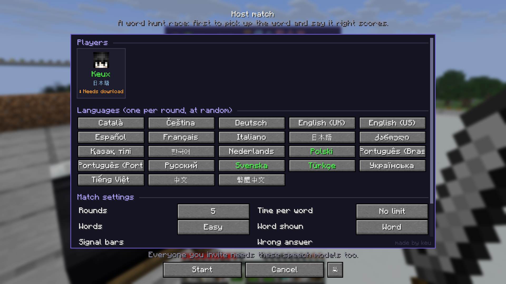
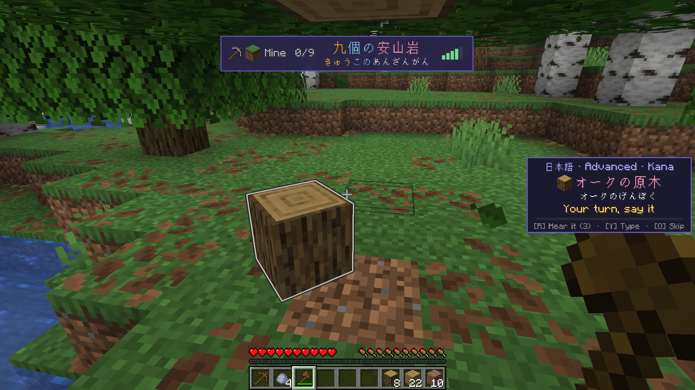
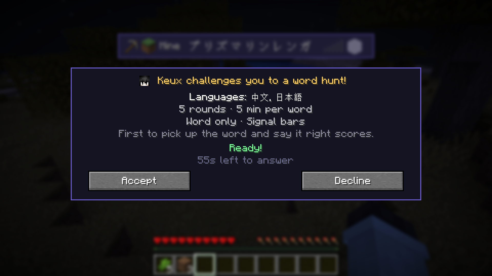
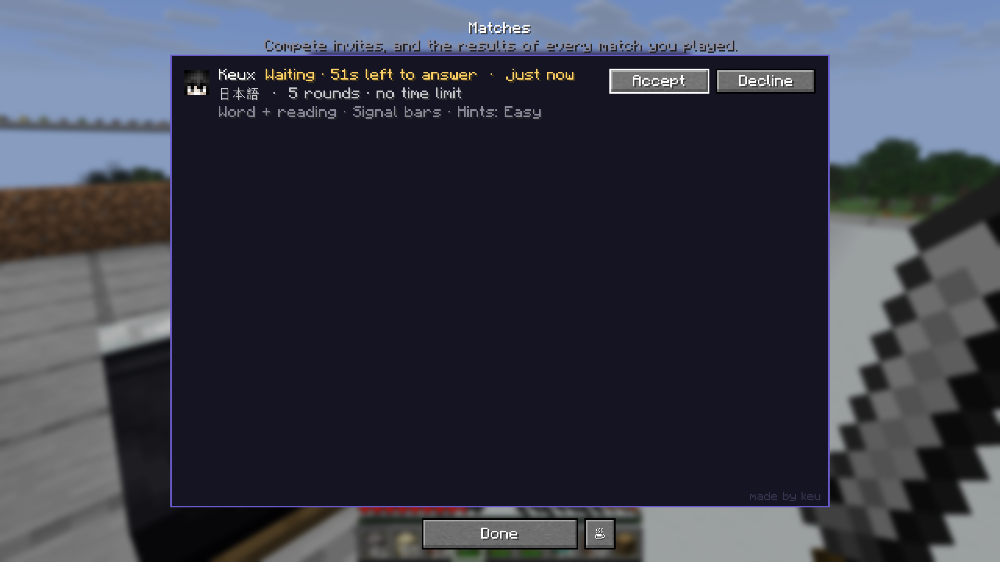
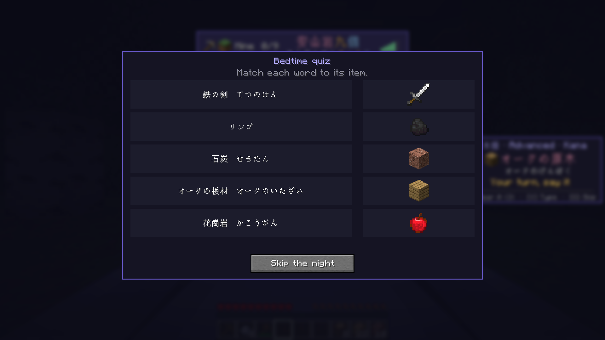
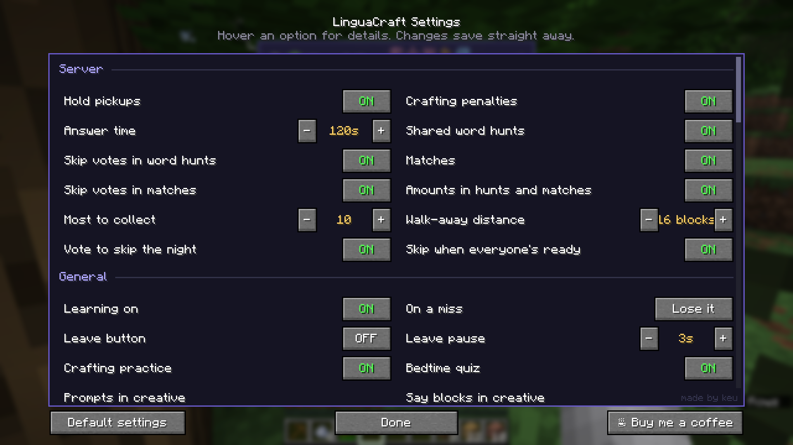

# LinguaCraft Server

### Learn a language together, and race each other in word hunts.

**[Download](https://github.com/ke-u/linguacraft-server/releases/latest)** &nbsp;·&nbsp;
**[Installation](#installation)** &nbsp;·&nbsp;
**[FAQ](#faq)** &nbsp;·&nbsp;
**[LinguaCraft](https://github.com/ke-u/linguacraft)** &nbsp;·&nbsp;
**[Report a bug](https://github.com/ke-u/linguacraft-server/issues)**

---

## About

**[LinguaCraft](https://github.com/ke-u/linguacraft)** already works on any server, with pickups as practice. Install **LinguaCraft Server** on your server and it plays the way singleplayer does: every item a LinguaCraft player picks up waits in the air until they say its name. On top of that you get **matches**, **shared word hunts** and **night skipping** for everyone.

It's server only: players install LinguaCraft on their own game, and players without it can still join and play normally.

---

## Features

**Say it to keep it, in multiplayer**
A picked-up item floats and glows while its player answers on the side card. Any other LinguaCraft player who walks into it gets the prompt too, and **whoever says it right first gets it**; everyone else's prompt closes. A wrong answer only takes that player out of the running: once nobody is left, the item is lost or stays on the ground, following the last player's settings. Walk too far away (16 blocks by default) and your prompt closes, leaving the item for anyone else.

**Matches**
Players host a word hunt match from *Word hunts → Host match*: **Compete** (the first to pick up the round's word and say it right scores) or **Co-op** (find them together). Each round uses one of the host's chosen languages, and the host sets the rounds, time per word, easy or hard words, how the word is shown, signal bars, hints and penalties. Rounds can ask for an amount too ("find 5 sand"): every pickup is asked about, then the count.

Invited players get a pop-up with the rules, and can answer later under **Matches**, where every match they've played is kept. Anyone missing a speech model is offered the download.

| Command | What it does |
|---|---|
| `/linguacraft compete <players>` | Open the match setup with those players ticked |
| `/linguacraft compete leave` | Leave your match |
| `/linguacraft compete stop` | End your match for everyone (the player who started it) |

**Shared word hunts**
Everyone with LinguaCraft hunts the same word together, each in the language they're learning, with votes to skip it.

**Nights**
Lying in a bed opens LinguaCraft's bedtime quiz. The night is skipped once every player in the Overworld has been to bed and done their quiz (they don't have to be in bed at the same time), and the night waits for anyone still answering. Players can also vote to skip it from their bed (half the Overworld).

**Crafting has stakes too**
A missed word for something a player crafted takes it back, as in singleplayer.

**Settings in game**
Operators can change every setting in game under LinguaCraft's *Settings → Server*, and changes reach everyone straight away.

---

## Installation

**Requirements**
- A Minecraft Java Edition **1.20.1**, **1.21 / 1.21.1** or **26.3** server
- [Fabric Loader](https://fabricmc.net/use/server/)
- [Fabric API](https://modrinth.com/mod/fabric-api)

**Steps**
1. Download `linguacraft-server-x.x.x+<your version>.jar` from the **[releases page](https://github.com/ke-u/linguacraft-server/releases/latest)**.
2. Put it in the server's `mods` folder, with Fabric API. Don't put LinguaCraft itself on the server.
3. Restart the server. Players install **[LinguaCraft](https://github.com/ke-u/linguacraft)** (and optionally **LinguaCraft Voices** and **LinguaCraft Counting**) on their own game.

**Settings** are in `config/linguacraft/server.json`:

| Setting | Default | What it does |
|---|---|---|
| `holdItems` | `true` | Hold picked-up items until the player answers. Off: pickups are practice (matches still work). |
| `craftPenalties` | `true` | Take crafted items back after a missed crafting word. |
| `answerTimeoutSeconds` | `120` | A held item drops back down after this long without an answer. |
| `walkAwayBlocks` | `16` | Walk further than this from an item you're asked about and its prompt closes. `0`: off. |
| `sharedHunts` | `true` | Everyone hunts the same word together. |
| `sharedSkipVotes` | `true` | Players can vote to skip the shared word. |
| `matches` | `true` | Players can host matches. |
| `matchSkipVotes` | `true` | Players can vote to skip a match's word. |
| `amounts` | `false` | Word hunts and match rounds ask for an amount (find 5 sand). |
| `maxAmount` | `10` | The most an amount can ask for. |
| `nightSkipReady` | `true` | Skip the night once everyone has been to bed and done their quiz. |
| `nightSkipVote` | `true` | Players can vote to skip the night from their bed. |

The server log lists the main settings at startup, and night-skip decisions are logged with `[Night]`.

---

## Compatibility

| | |
|---|---|
| **Minecraft** | 1.20.1, 1.21 / 1.21.1 and 26.3, each with its own jar. |
| **Players without LinguaCraft** | Can join and play normally. Nothing changes for them. |
| **Other LinguaCraft versions** | Players whose LinguaCraft doesn't match this add-on just aren't held for: their pickups are practice, and nobody is ever disconnected. Keep the add-on up to date. |
| **Performance** | Light. No work per tick beyond a once-a-second check while items are held, and matches do nothing while none is running. Learning and speech all happen on each player's own computer. |
| **Worlds** | No new blocks or items, so it never affects world saves or vanilla clients. |

---

## FAQ

<b>Do players need anything?</b>

 
LinguaCraft on their own game, for the matching Minecraft version. LinguaCraft Voices and Counting are optional.

<b>The night never skips. What do I check?</b>

 
Look in the server log for lines starting with <code>[Night]</code>: they say why a night was or wasn't skipped. Check that <code>nightSkipReady</code> is on, and that every player in the Overworld has been to bed and finished their quiz.

<b>Can someone grab an item they weren't asked about?</b>

 
No. Only players who were asked about an item can answer for it, and a held item drops back down after a timeout or when its player leaves.

---

## Permissions

- **Any server**, public or paid, can run it. A link to the mod page is appreciated.
- **Modpacks:** Yes, as long as the pack downloads it from this page or the official Modrinth / CurseForge pages.
- **Re-uploading:** No. Please link here instead.

---

## Support the mod

LinguaCraft is free and always will be. If it's helped your server learn a few words and you'd like to say thanks,
you can **[buy me a coffee on Ko-fi](https://ko-fi.com/linguacraft)**. It's never expected, but always appreciated.

---

## Credits

**Made by keu**

LinguaCraft Server © keu. All rights reserved. NOT AN OFFICIAL MINECRAFT PRODUCT. NOT APPROVED BY OR ASSOCIATED WITH MOJANG OR MICROSOFT.
