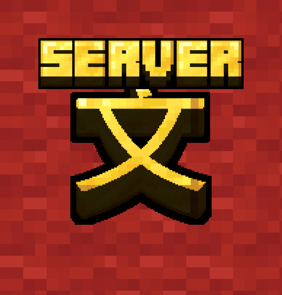

# LinguaCraft Server

### Learn a language together, and race each other in word hunts.

**[Download](https://github.com/ke-u/linguacraft-server/releases/latest)** &nbsp;·&nbsp;
**[LinguaCraft](https://github.com/ke-u/linguacraft)** &nbsp;·&nbsp;
**[Report a bug](https://github.com/ke-u/linguacraft-server/issues)**

---

**The server add-on for LinguaCraft: learn a language together, and race each other in word hunts.**

LinguaCraft already works on any server, with pickups as practice. Install this on your server and it plays the way singleplayer does: every item a LinguaCraft player picks up waits in the air until they say its name, and you get **compete mode**.

---

## What it adds

**Say it to keep it, in multiplayer**
A picked-up item floats and glows while its player answers. Any other LinguaCraft player who walks into it gets the prompt too, and **whoever says it right first gets it**; everyone else's prompt closes. A wrong answer only takes that player out of the running: once nobody is left, the item is lost or stays on the ground, following the last player's settings.

**Compete mode**
Race other players in a word hunt, 1v1 or everyone against everyone. Each round, everyone gets the same word in one of the chosen languages, and the first to pick up that item and say it right scores. The host sets the match: rounds (3 to 10), time per word, easy or hard words, how the word is shown (with its reading, word only, or sound only), signal bars on or off, and whether a wrong answer costs a point. Start a match from the **Compete** button on the word hunts screen (**H**), or with a command:

| Command | What it does |
|---|---|
| `/linguacraft compete <players>` | Open the match setup with those players ticked |
| `/linguacraft compete leave` | Leave your match |
| `/linguacraft compete stop` | End your match for everyone (the player who started it) |

Every player needs the speech models for the match's languages; the invite offers to download any that are missing.

**Crafting has stakes too**
A missed word for something a player crafted takes it back, as in singleplayer.

---

## Built for busy servers

- **Players without LinguaCraft can join and play normally.** Nothing changes for them.
- **Any LinguaCraft version can join.** Players whose LinguaCraft doesn't match this add-on just aren't held for; their pickups are practice, and nobody is ever disconnected.
- **Light.** No work per tick beyond a once-a-second timeout check while items are held, and compete mode does nothing while no match is running. Learning and speech all happen on each player's own computer.
- **Safe.** Only players who were asked about an item can answer for it, a held item drops back down after a timeout or when its player leaves, and there's a cap on how many items are held per player.
- **No new blocks or items**, so it never affects world saves or vanilla clients.

---

## Installation

1. Your server needs **Fabric Loader** and **Fabric API**.
2. Download `linguacraft-server-x.x.x+<your version>.jar` from **[Releases](https://github.com/ke-u/linguacraft-server/releases/latest)** and put it in the server's `mods` folder (pick the one for your Minecraft version: 1.20.1, 1.21.1 or 26.3).
3. Restart the server. Players install **LinguaCraft** (and optionally **LinguaCraft Voices**) on their own game.

Keep this add-on up to date: new versions keep working with older LinguaCraft releases where they can.

**Settings** are in `config/linguacraft/server.json`:

| Setting | Default | What it does |
|---|---|---|
| `holdItems` | `true` | Hold picked-up items until the player answers. Off: pickups are practice (compete still works). |
| `craftPenalties` | `true` | Take crafted items back after a missed crafting word. |
| `answerTimeoutSeconds` | `120` | A held item drops back down after this long without an answer. |
| `maxHeldPerPlayer` | `32` | Most items held for one player at once. |

---

## Permissions

- **Any server**, public or paid, can run it. A link to the mod page is appreciated.
- **Modpacks:** yes, as long as the pack downloads it from this page or the official Modrinth / CurseForge pages.
- **Re-uploading:** no. Please link here instead.

Found a bug? **[Open an issue](https://github.com/ke-u/linguacraft-server/issues)**. Enjoying it? **[Support LinguaCraft on Ko-fi](https://ko-fi.com/linguacraft)**.
